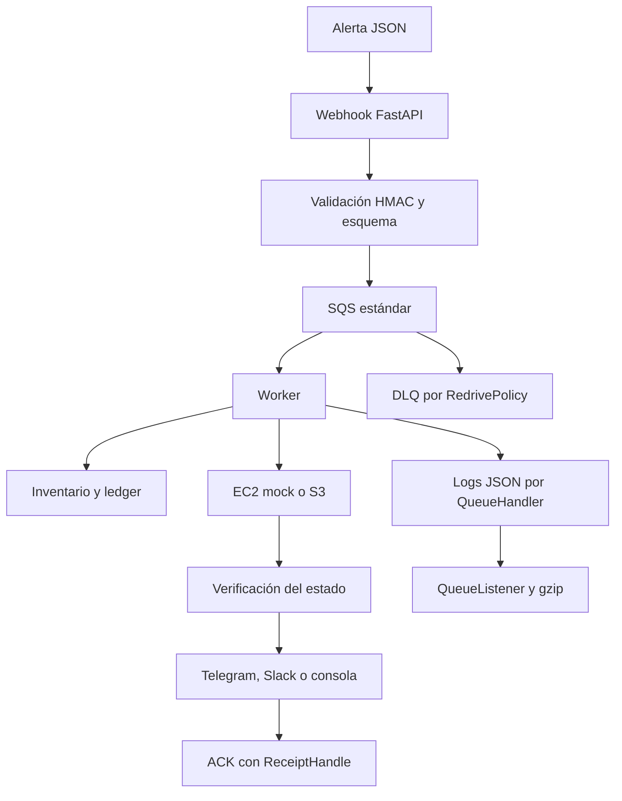

# Proyecto Fénix — Sistema de Autorreparación de Infraestructura

## Objetivo del sistema

Fénix recibe alertas de laboratorio mediante un webhook autenticado con HMAC-SHA256. El receptor valida el evento y lo publica en una cola SQS estándar. Un worker independiente procesa el mensaje, consulta el estado real de un recurso emulado en LocalStack, aplica una reparación convergente y envía una notificación. El mensaje solo se confirma después de completar la reparación y el aviso.

El laboratorio contempla dos casos: `node-01` (EC2 mock: `stopped` → `running`) y `bucket-01` (S3: recuperar etiquetas obligatorias). Una instancia EC2 mock no es una máquina virtual Linux real.

## Responsable del proyecto

| Modalidad | Apellido y nombre | Correo | Responsabilidad | Pruebas a defender |
|---|---|---|---|---|
| Trabajo individual | Mateo Ismael Liendro | liendromateo66@gmail.com | Desarrollo e integración completa del sistema | Todas las pruebas del proyecto |

El proyecto se desarrolla y presenta de manera individual. La responsabilidad sobre la implementación, integración, pruebas y defensa corresponde al estudiante indicado.

## Prerrequisitos y versiones

- Windows 10/11 de 64 bits o Linux/macOS.
- Python 3.11 o superior.
- Docker Desktop con WSL 2 y Docker Compose.
- Imagen de LocalStack aprobada por la cátedra y token si el plan lo requiere.
- Git recomendado para versionado.
- No se utilizan credenciales reales de AWS. Python corre en el equipo anfitrión; LocalStack corre en Docker.

## Instalación desde cero (PowerShell)

Desde la carpeta del proyecto:

```powershell
python -m venv .venv
.\.venv\Scripts\Activate.ps1
python -m pip install --upgrade pip
python -m pip install -e .
Copy-Item .env.example .env
python -c "import secrets; print(secrets.token_urlsafe(32))"
```

Copiar el valor generado en `WEBHOOK_SECRET` dentro de `.env`. Completar `LOCALSTACK_AUTH_TOKEN` solo si la imagen adoptada lo requiere. No compartir ni subir `.env`.

Después de instalar las dependencias en el entorno definitivo, generar el archivo de versiones efectivamente utilizadas:

```powershell
python -m pip freeze > requirements-lock.txt
```

## Variables de entorno

Ver `.env.example`. Las variables principales son:

- `AWS_ENDPOINT_URL`: debe apuntar a `http://localhost:4566`.
- `AWS_ACCESS_KEY_ID`, `AWS_SECRET_ACCESS_KEY`: credenciales ficticias para LocalStack.
- `AWS_DEFAULT_REGION`: región del laboratorio.
- `GROUP_ID`: identificador propio del estudiante/proyecto.
- `QUEUE_PREFIX`: prefijo único de las colas.
- `WEBHOOK_SECRET`: clave compartida del webhook, mínimo 16 caracteres.
- `NOTIFY_PROVIDER`: `console`, `telegram` o `slack`.
- `TELEGRAM_BOT_TOKEN`, `TELEGRAM_CHAT_ID` o `SLACK_WEBHOOK_URL`: configuración del proveedor elegido.
- `LOCALSTACK_IMAGE` y `LOCALSTACK_AUTH_TOKEN`: configuración de la imagen local.

Los secretos y credenciales deben mantenerse en `.env`, que no debe subirse al repositorio.

## Arquitectura



## Contratos de entrada y salida

El evento JSON tiene exactamente estos campos:

```json
{
  "schema_version": 1,
  "event_id": "evt-node-001",
  "event_type": "instance.stopped",
  "resource_id": "node-01",
  "occurred_at": "2026-10-22T18:00:00Z",
  "simulate_failures": 0
}
```

- `schema_version` debe ser el entero 1.
- `event_id` y `resource_id` cumplen `[a-z0-9-]{3,32}`.
- `event_type` admite `instance.stopped` o `bucket.tags_missing`, según el tipo del alias en el inventario.
- `occurred_at` requiere UTC explícito.
- `simulate_failures` es un entero entre 0 y 5; no se acepta `bool`.

El receptor devuelve HTTP 202 únicamente después de que SQS confirme `send_message`. La respuesta contiene `status`, `event_id` y `message_id`. `MessageId` identifica el mensaje SQS; `ReceiptHandle` identifica la recepción actual y se usa para el ACK.

## Ejecución

1. Iniciar Docker Desktop.
2. Desde la carpeta del proyecto, iniciar LocalStack:

```powershell
docker compose up -d
```

3. Crear las colas y los recursos del laboratorio:

```powershell
python -m fenix.cli init-queues
python -m fenix.cli setup-demo
```

4. Terminal 1: iniciar el receptor:

```powershell
python -m uvicorn fenix.services.receiver:app --host 127.0.0.1 --port 8000 --workers 1 --env-file .env
```

5. Terminal 2: iniciar el worker:

```powershell
python -m fenix.cli worker
```

6. Terminal 3: generar una falla y enviar el evento:

```powershell
python -m fenix.cli fault node-01
python -m fenix.cli send examples/node-event.json
```

El receptor debe responder HTTP 202 cuando el evento se publica correctamente en SQS.

Para el bucket:

```powershell
python -m fenix.cli fault bucket-01
python -m fenix.cli send examples/bucket-event.json
```

Actualizar `occurred_at` y utilizar un `event_id` nuevo para cada incidencia nueva. Para un ensayo de dos fallas temporales, copiar el JSON y cambiar `event_id` y `simulate_failures` a 2. Para DLQ, utilizar otro ID y `simulate_failures` a 5.

## Reintentos, DLQ e idempotencia

La cola principal es estándar y utiliza `VisibilityTimeout=45`, retención de cuatro días y `RedrivePolicy` hacia una DLQ con `maxReceiveCount=3`. Ante un fallo, el worker cambia la visibilidad del mensaje actual con demora `min(30, 2 ** ApproximateReceiveCount)`. No crea una copia nueva del mensaje.

El ledger `data/events.json` conserva el evento asociado a cada `event_id`, cantidad de intentos, reparación, resultado, aviso y estado. Si un `event_id` reaparece con otro contenido, se rechaza como conflicto. Las etapas verificadas no se repiten al volver a recibir un duplicado.

No se promete entrega exactamente una vez: SQS estándar ofrece entrega al menos una vez y existe una ventana entre un efecto externo y su persistencia local.

## Pruebas

La suite completa se ejecutó con:

```powershell
python -m pytest -q
```

**Resultado obtenido: 25 pruebas aprobadas.**

Además, se realizó una prueba de integración del flujo principal con LocalStack.

| Verificación | Resultado observado |
|---|---|
| Inicialización de colas SQS | Correcta |
| Creación de recursos de demostración | Correcta |
| Envío del evento mediante webhook | HTTP 202 Accepted |
| Procesamiento del evento por el worker | Correcto |
| Reparación de `node-01` | Correcta |
| Estado final de EC2 consultado mediante Boto3 | `running` |
| Notificación real por Telegram | Recibida correctamente |
| Suite automatizada | 25 pruebas aprobadas |

El evento utilizado en la demostración fue `evt-node-001`.

Mensaje recibido en Telegram:

`Fénix: instance.stopped en node-01; resultado=repaired; evento=evt-node-001`

La prueba confirma el recorrido del evento desde el webhook hasta la reparación y la notificación. El caso del bucket debe verificarse por separado si se desea presentar como demostración práctica.

## Observabilidad y evidencia

Los logs se guardan en `logs/` como JSON Lines. `QueueHandler` entrega registros a una `queue.Queue` en memoria y `QueueListener` escribe en un archivo rotativo; esta cola de logging no reemplaza a SQS. Los históricos se comprimen con gzip.

Se recopilaron evidencias del funcionamiento del sistema:

- Respuesta HTTP 202 del webhook.
- Notificación de reparación recibida en Telegram.
- Consulta mediante Boto3 que confirma el estado final `running` de la instancia EC2.
- Resultado de la suite automatizada: 25 pruebas aprobadas.

Las capturas y archivos de evidencia deben ocultar tokens, firmas, credenciales y datos sensibles.

## Limitaciones

- LocalStack emula las APIs de AWS; la instancia EC2 mock no ejecuta un sistema operativo real.
- El ledger JSON presupone un solo proceso escritor.
- No existe una transacción distribuida entre SQS, el archivo local, el recurso cloud y el proveedor de avisos.
- Si el proceso cae después del envío externo y antes de guardar `notified`, podría repetirse el aviso.
- La integración con Telegram fue comprobada mediante un envío real.
- La reparación de EC2 fue verificada en LocalStack mediante una consulta Boto3.

## Limpieza del laboratorio

Detener primero el worker y el receptor. Conservar `data/inventory.json` mientras se necesite reconocer los recursos creados. Antes de eliminar recursos, consultar los IDs del inventario y borrar exclusivamente los recursos creados para este proyecto individual. No borrar recursos por nombre sin verificar sus etiquetas de propiedad.

## Defensa del proyecto

- Video de defensa: pendiente de grabación y publicación.
- Enlace al video: pendiente.
- Marcas de tiempo: se completarán al publicar el video.

## Declaración de ayuda externa e IA

Se utilizó ChatGPT como apoyo para interpretar la consigna, revisar la plantilla, proponer y corregir código y preparar la defensa. El código final fue ejecutado y revisado por el estudiante, quien es responsable de comprender y explicar su funcionamiento.